# Transaction concurrency audit

**Scope:** every operation that moves investor money (subscriptions, deposits, gateway and payout callbacks, rent/returns crediting, referral commission, wallet adjustments, withdrawals, approvals, payouts, refunds, scheduled jobs), traced from API to database.
**Method:** code review of controllers, services, repositories and Flyway migrations, plus a new concurrency test suite run against PostgreSQL (Testcontainers).
**Status:** audit only. No production code was changed. The remediation below is proposed, not applied.

Paths: Java files are under `backend/src/main/java/com/sealease/backend/`, migrations under `backend/src/main/resources/db/migration/`. Line numbers refer to commit `8a95bf4` (main).

---

## 1. Executive summary

The money paths are well built. The platform uses a double-entry ledger whose rows can't be edited or deleted. Transactions must balance (checked in code and again by a deferred database trigger). Spending from a wallet takes a row lock, and every posting has a unique reference. Under 100 parallel requests, no test produced a double withdrawal, double credit, double payout, double refund, lost update or negative balance.

**No CRITICAL concurrency defect was found.** Four HIGH findings need fixing before high-traffic or multi-instance production use:

| ID | Finding | Effect today |
|----|---------|--------------|
| H-1 | Several flows read a row, then lock the same row later in the transaction; Hibernate refuses the newer locked version | Measured: 19 of 30 concurrent Razorpay deliveries and 6 of 30 payout deliveries answered **HTTP 409**. They are recorded only when the provider retries. Money stays correct (row version checks catch it). |
| H-2 | A withdrawal request holds one pooled connection and opens a second one for the password check | Measured: with 100 requests at once, **50–52 failed with HTTP 500** after the 10 s pool timeout (pool 20/20, about 95 threads waiting) |
| H-3 | Bank references (UTR / receipt numbers) are not unique for manually confirmed deposits or for withdrawal payouts | One bank reference can confirm several deposits or mark several withdrawals paid. A single finance user can confirm an investment for money that never arrived. |
| H-4 | A Razorpay or payout webhook for a reference that isn't ours is only logged | Money received this way leaves no record to reconcile or refund |

There are also 8 MEDIUM findings (lock contention, an external call made while holding a lock, the single scheduler thread, no lock timeouts) and 5 LOW findings. **All 8 MEDIUM and all 5 LOW findings are fixed** (branch `fix-medium-concurrency-issues`); see "Done" under each.

> **Status: all four HIGH findings are fixed** (branch `fix-high-concurrency-issues`). The two acceptance tests are enabled and pass. The burst of 100 withdrawal requests now gets no 500s, and all 30 concurrent Razorpay and payout deliveries are answered 200. See "Fix" under each finding below.

> H-2 comes from the withdrawal-management change merged in PR #15 (`UserAccountService.confirmPassword` running in `REQUIRES_NEW`). It is a regression from that change, not a long-standing issue.

---

## 2. Financial transaction inventory

| # | Operation | Entry point | Transaction & locks | Duplicate protection | Verdict |
|---|-----------|-------------|---------------------|----------------------|---------|
| 1 | Investment subscription (checkout) | `POST /api/v1/orders` → `order/service/OrderService.java:126` | `@Transactional`; `pg_advisory_xact_lock(user:key)` (`OrderService.java:130`, `order/repository/OrderRepository.java:26`) | `orders_idempotency_uk (user_id, idempotency_key)` (V3:92); request hash checked on replay | Safe. No shared capacity to race on (`investment/service/OfferingQuery.java:44-51`) |
| 2 | Start payment (bank / cash / Razorpay) | `POST /api/v1/orders/{id}/payments` → `payment/service/PaymentService.java:146` | Order row `FOR UPDATE` (`:149`) | `payments_idempotency_uk` (V3:102), `payments_one_pending_uk` (V3:526) | Safe for money; **M-1** (external call under lock) |
| 3 | Investor submits deposit / receipt details | `PaymentService.java:247`, `:284` | Order → payment locks | Status re-check | **H-1 pattern** (`load` at `:248`/`:285` before lock at `:256`/`:293`) |
| 4 | Finance confirms bank/cash deposit | `POST /api/v1/admin/payments/{id}/confirm` → `PaymentService.java:393` | Order → payment locks; assignee only | `payments_one_succeeded_uk` (V3:527); exact-amount check (`:417-421`) | **H-3** (reference not unique), **H-1 pattern** (`:394` before `:403`) |
| 5 | Razorpay checkout verification | `payment/gateway/GatewayPayments.java:45` (not transactional) → `PaymentService.recordGatewayPayment` | Order → payment locks | Signature + Razorpay fetch; `payments_gateway_payment_uk` (V13:25) | Safe for money; **H-1** |
| 6 | Razorpay webhook | `POST /api/v1/webhooks/razorpay` → `GatewayPayments.java:70` → `PaymentService.java:336` | Order → payment locks | HMAC; `(provider, external_reference)` unique; capture is outside the DB transaction | Safe for money; **H-1**, **H-4** |
| 7 | Order confirmation (creates holdings, invoice) | `OrderService.java:248` (inside #4/#5/#6) | Order lock held by caller | `holdings_order_item_uk` (V3:36), `invoices_order_uk` (V3:50) | Safe |
| 8 | Order expiry job | `order/service/OrderExpiryJob.java:19` → `OrderService.java:190` | Per order `FOR UPDATE` + re-check (`:202-206`) | Status re-check | Safe (tested: 5 overlapping sweeps → 1 expiry) |
| 9 | Refund of a payment | `POST /api/v1/admin/payments/{id}/refund` or approval → `PaymentService.java:458` | Payment `FOR UPDATE` (`:459`) | Status must be `REFUND_REQUIRED` (`:463`) | Safe (tested: 10 concurrent → 1 refund) |
| 10 | Lease start (agreement accepted) | `order/service/AgreementAcceptanceService.java:39` | Holding `FOR UPDATE` (`investment/service/HoldingService.java:73`) | `rent_accruals_holding_uk` (V3:134) | Safe |
| 11 | Returns (rent) crediting job | `earning/service/PayoutJob.java:20` → `earning/service/PayoutService.java:135` | One transaction per lease; accrual `FOR UPDATE` + re-check (`:164-172`) | Ledger `(INVESTOR_PAYOUT, holding:from)` unique; `rent_credits_from_uk` (V3:140) | Safe (tested: 8 overlapping sweeps → each hour once) |
| 12 | Referral commission (monthly) | `referral/service/ReferralCommissionService.java:88` (same transaction as #11) | Inherits #11 | Ledger ref = credit id; `referral_earnings_credit_level_uk` (V3:531) | Safe |
| 13 | Referral commission (one-time) | `ReferralCommissionService.java:149` | Referrer row lock (`:152`) | Ledger ref `one-time:user`; `referral_earnings_one_time_uk` (V3:533) | Safe |
| 14 | Wallet adjustment (maker-checker) | `approval/service/ApprovalService.java:93` → `ledger/service/LedgerService.java:143` | Approval row `FOR UPDATE`; wallet `FOR UPDATE` (`LedgerService.java:156`, `:189`) | Ledger ref `user:approval-id`; overdraft check under lock (`:164`) | Safe (tested: concurrent debits/credits/withdrawal) |
| 15 | Online withdrawal request | `POST /api/v1/withdrawals` → `withdrawal/service/WithdrawalRequestService.java:110` | Wallet `FOR UPDATE` (`:128`), idempotency re-check under lock (`:129`) | `withdrawals_one_open_uk` (V22:42), `withdrawals_idempotency_uk` (V3:192), ledger ref = withdrawal id | Safe for money; **H-2** |
| 16 | Cancel / reject / hold / resume | `WithdrawalRequestService.java:172`, `withdrawal/service/WithdrawalReviewService.java:157-205` | Withdrawal `FOR UPDATE` | Release ledger ref = withdrawal id (`withdrawal/service/WithdrawalService.java:183`) | Safe (tested: approve vs cancel ×5) |
| 17 | Review take / approve (dual control) | `WithdrawalReviewService.java:86`, `:128` | Withdrawal `FOR UPDATE` | `withdrawals_not_own_chk`; second approver ≠ first | Safe (tested: 5 takers → 1, 4 second approvers → 1); **M-2** (DB does not require approvals) |
| 18 | Initiate payment | `POST /admin/withdrawals/initiate-payment` → `withdrawal/service/WithdrawalPaymentService.java:99` | Withdrawals locked in sorted id order (`:104-105`) | Status `APPROVED` required | Safe (tested: 5 concurrent → 1 batch) |
| 19 | Payout webhook | `POST /api/v1/webhooks/payouts` → `WithdrawalPaymentService.java:161` | Batch → withdrawal locks (`withdrawal/service/PayoutBatchService.java:389-390`) | `payout_webhook_events_uk` (V22:100); exact net amount check; ledger ref = withdrawal id | Safe for money; **H-1**, **H-3** |
| 20 | Mark paid / failed (finance task, batch) | `withdrawal/service/FinanceTaskService.java:159` → `PayoutBatchService.java:259`, `:270` | Batch → withdrawal locks | UTR required for bank (`:369-374`); ledger ref unique | **H-3**; **H-1 pattern** (`FinanceTaskService.java:160`) |
| 21 | Resolve failed payout | `PayoutBatchService.java:283` | Withdrawal `FOR UPDATE` | Status `FAILED` required | Safe |
| 22 | Withdrawal run (network investors) | `withdrawal/service/WithdrawalRunService.java:119` | **One transaction for all investors**; wallet lock each (`:156`) | Open-withdrawal check under lock (`:160-169`) | Safe for money; **M-3** (long transaction) |
| 23 | Outbox relay (Kafka) | `outbox/OutboxRelay.java:64` | `FOR UPDATE SKIP LOCKED` (`:37-44`) | Consumers de-duplicate (`processed_events` PK) | Safe; no consumer moves money; **L-3** |

**Not present in the codebase:** a "deposit wallet" (investments are paid per order), and any Kafka consumer that moves money.

---

## 3. Critical vulnerability list

**None.** Every path that can create, move, settle or reverse money is protected by at least two independent controls:

- a row lock with a status re-check, plus
- a database uniqueness rule (on the ledger reference or the business row).

The concurrency tests in section 9 confirm this under load. The HIGH findings below can still cause financial inconsistency or depend on staff behaviour.

---

## 4. File-level findings

### HIGH

**H-1: Read, then lock the same row: concurrent deliveries are answered 409** (fixed)

- **Pattern.** The entity is loaded without a lock, and the same transaction later runs a `PESSIMISTIC_WRITE` query for it. If another transaction committed a change in between, Hibernate raises *"Query result contains conflicting version of entity already held in persistence context"* (mapped to 409) and rolls back.
- **What it means.** The comments say "re-checked under the lock", but the check actually runs on the stale copy. Only the `@Version` column (`common/persistence/BaseEntity.java:34`) stops a wrong update.
- **Locations:**
  - `payment/service/PaymentService.java:338` reads, then `:344` locks. This is the Razorpay webhook and checkout path. Measured: 19/30 concurrent credits answered 409.
  - `withdrawal/service/WithdrawalPaymentService.java:173` reads, then `withdrawal/service/PayoutBatchService.java:384` peeks and `:390` locks. This is the payout webhook. Measured: 6/30 answered 409.
  - Same pattern with lower exposure:
    - `PaymentService.java:248→256` (submit deposit), `:285→293` (submit receipt), `:394→403` (confirm), `:432→440` (reject);
    - `withdrawal/service/FinanceTaskService.java:160` (the assignee check runs on the unlocked copy) → `PayoutBatchService.java:439`.
- **Impact:**
  - A transfer that lost the race (for example a second transfer into a virtual account, which must be set aside for refund) is not recorded until Razorpay redelivers. If redelivery stops, the money is unrecorded.
  - Staff see spurious "conflict" errors.
- **Fix:**
  - Take the lock first. Either look up only the id (a projection query), then lock, or call `entityManager.refresh(entity, LockModeType.PESSIMISTIC_WRITE)` on the instance already loaded.
  - On webhook endpoints, retry once internally on `OptimisticLockingFailureException` before answering.
- **Done.**
  - Every location above now reads only ids (projection queries `PaymentKeys`, `PayoutKeys`, `findBatchIdById`, `findStatusById`) and loads the entity for the first time with its lock.
  - The finance-task assignee check runs on the locked withdrawal.
  - With locking done this way, no internal retry was needed. Measured afterwards: 30/30 Razorpay and 30/30 payout deliveries answered 200, and 10/10 extra transfers were set aside for refund on the first delivery.

**H-2: A burst of withdrawal requests exhausts the connection pool (regression from PR #15)** (fixed)

- **Code.** `withdrawal/service/WithdrawalRequestService.java:111` runs a query inside the request transaction, so it holds a connection. Then `:119` calls `user/service/UserAccountService.java:150` (`REQUIRES_NEW`), which needs a second connection. That method then does a bcrypt check while holding the `users` row lock.
- **Measured (100 parallel requests):** 1 created, 46 correctly refused ("already in progress"), **50–52 HTTP 500** (`Connection is not available, request timed out after 10000ms`), and 1–3 requests that never returned. p50 latency was 10.3 s.
- **Money stayed correct**: one withdrawal and one reserve.
- **Fix.** Check the password before the request transaction starts:
  - make `submit` a non-transactional coordinator that calls `confirmPassword` and then a `@Transactional` method; or
  - move the database read at `:111` after the password check, with no transaction open.
- **Done.**
  - `submit` is no longer `@Transactional`. It runs the idempotency lookup, the scheme check and the password check first, each in its own short transaction.
  - The wallet lock, reservation and save then run in one `TransactionTemplate`, which re-checks the idempotency key under the lock.
  - Measured afterwards: 100 parallel requests gave 1 created, 99 refused (409) and 0 server errors.
- The acceptance test `aBurstOfWithdrawalRequestsIsAnsweredWithoutServerErrors` is ready, currently `@Disabled`.

**H-3: Bank and cash references can be reused** (fixed)

- **Deposits.**
  - `PaymentService.java:393-424` accepts any `externalReference` (UTR / receipt) when finance confirms a bank or cash deposit.
  - Uniqueness only exists for Razorpay rows (`ddl/V13__payment_gateway.sql:23-26`).
  - Confirmation needs one person (`PAYMENT_CONFIRM`) and has no checker.
- **Withdrawals.**
  - `PayoutBatchService.java:369-374` requires a UTR but never checks whether it was already used.
  - There is no unique index on `withdrawals.payout_reference`. The same applies to the webhook's `providerReference`.
- **Impact:**
  - A mistyped or reused UTR confirms an investment whose money never arrived. Holdings are created and returns are then paid on them.
  - Two withdrawals can be marked paid from one bank transfer, so the ledger shows money out that was never sent.
- **Fix:**
  - Add partial unique indexes after checking existing data for duplicates:

    ```sql
    -- deposits confirmed by finance
    CREATE UNIQUE INDEX payments_manual_reference_uk ON payments (method, upper(external_reference))
      WHERE method IN ('BANK_TRANSFER','OFFICE_CASH') AND status IN ('SUCCEEDED','REFUND_REQUIRED','REFUNDED');
    -- withdrawals paid by bank
    CREATE UNIQUE INDEX withdrawals_payout_reference_uk ON withdrawals (upper(payout_reference))
      WHERE payout_method = 'BANK_TRANSFER' AND status = 'PAID';
    ```

  - Return a clear "reference already used for …" error.
  - Consider a second approver for deposits above the dual-approval threshold, using the existing `approval` module.
- **Done.**
  - **Database (`ddl/V23`).** `payments_manual_reference_uk` covers bank and cash deposits for any reference finance records. `withdrawals_payout_reference_uk` covers paid bank-transfer withdrawals. Both ignore case. The migration first checks existing data and stops with the queries to find duplicates.
  - **Service checks.** These give a clear 409 that names the other record:
    - `confirmBankTransfer` refuses a reused reference;
    - `PayoutBatchService.pay` (finance tasks and batches) refuses a reused UTR;
    - a payout webhook with a reused UTR is left `NEEDS_RECONCILIATION` instead of paying.
  - **Cash receipts.** One cash receipt may still cover several payouts that **one** investor collects at once (an existing rule). The service refuses it for another investor.
  - The deposit maker-checker is not done; it remains a recommendation.

**H-4: Gateway money with no matching payment is only logged** (fixed)

- **Code.** `PaymentService.java:339-342`: when `virtual_account.credited` or `payment.captured` names a reference that isn't ours, the method logs a warning and the webhook answers 200.
- **Impact.** Money that reached the company's Razorpay account leaves no row for finance to reconcile or refund.
- **Fix.** Persist it to an `unmatched_gateway_receipts` table (provider, ids, amount, payload, received_at) and list it for finance.
- **Done.**
  - `ddl/V23` adds `unmatched_gateway_receipts`, unique per `(provider, gateway_payment_id)`.
  - `UnmatchedGatewayReceipts.record` stores each receipt once (a redelivery changes nothing) and audits it (`PAYMENT_UNMATCHED_RECEIVED`).
  - Finance lists receipts with `GET /api/v1/admin/payments/unmatched` (`FINANCE_VIEW` or `PAYMENT_CONFIRM`). They close each one with a note via `POST /api/v1/admin/payments/unmatched/{id}/resolve` (`PAYMENT_CONFIRM`, audited `PAYMENT_UNMATCHED_RESOLVED`).
  - Payout webhooks for an unknown reference were already stored in `payout_webhook_events`.
  - Admin screen: **Finance → Unmatched Receipts** (`/admin/payments/unmatched`) lists them and resolves each with a note.

### MEDIUM

**M-1: Razorpay is called while the order row is locked** (fixed)

- `PaymentService.java:149` locks the order, and `:221` then calls Razorpay to create an order or virtual account.
- Razorpay timeouts are 15 s for connect and 15 s for read (`payment/gateway/RazorpayProperties.java:29`, `HttpRazorpayClient.java:34-35`).
- **Measured:** an order cancel waited **1.3 s** behind a 1.5 s gateway call. Webhooks and the expiry sweep for that order wait the same way, and the request holds a pooled connection throughout.
- If the transaction rolls back after Razorpay succeeded, the virtual account it created is left open. It isn't closed, because closing is only registered for after-commit.
- **Fix.** Insert the `PENDING` payment, commit, call the provider outside the lock, then attach the result. Or keep the current flow but register a rollback hook that closes the provider object.
- **Done.**
  - `PaymentService.start` now takes three short steps:
    1. it checks the request under the order lock, changing nothing;
    2. it calls the provider with no transaction or lock held;
    3. it records the payment under the lock, after checking again.
  - Whatever the provider opened is closed if the payment isn't recorded (the order changed meanwhile, another request won, or recording failed).
  - Measured afterwards: the order cancel took **4 ms** (was 1.3 s) while the start waited for the gateway. The start then found the order cancelled (422), and the virtual account was closed.

**M-2: The database does not require approvals for investor-requested withdrawals** (fixed)

- `withdrawals_approved_chk` (`ddl/V2__tables.sql:1016`) exempts `origin = 'REQUESTED'`.
- Maker-checker for online withdrawals is enforced only in `WithdrawalReviewService.java:128-153`.
- **Fix:** add the rule to the database:

  ```sql
  CHECK (origin <> 'REQUESTED' OR status IN ('SUBMITTED','UNDER_REVIEW','ON_HOLD','PENDING_APPROVAL','REJECTED','CANCELLED')
         OR (first_approved_by IS NOT NULL AND (required_approvals = 1 OR second_approved_by IS NOT NULL)))
  ```
- **Done.** `ddl/V24` replaces `withdrawals_approved_chk` with the rule above.
  - Runs and office withdrawals stay exempt, as before; they are approved by how they are made.
  - The migration first checks existing data and stops with the query to find any offending rows.

**M-3: Withdrawal runs hold every wallet lock in one long transaction** (fixed)

- `WithdrawalRunService.java:118-200` processes every eligible investor in a single transaction and locks each wallet (`:156`) until the end.
- The wallet lock is `FOR UPDATE` (`LedgerService.java:189`). That blocks the `FOR KEY SHARE` lock PostgreSQL takes for every `ledger_entries` foreign-key insert.
- As a result, rent and commission credits to those investors wait until the whole run commits. The same applies to any withdrawal request or adjustment that holds a wallet.
- **Fix:**
  - Use `SELECT … FOR NO KEY UPDATE`. It still serialises spenders but no longer blocks credits.
  - Give each investor in a run its own transaction, and record the run's results row by row.
- **Done.**
  - `LedgerService.lockInvestorBalance` takes `FOR NO KEY UPDATE`.
  - Measured afterwards: a credit posted while a spender held the wallet took **4 ms**. With the old `FOR UPDATE` the same test hits the lock timeout.
  - **Kept as one transaction:** the run itself. Its withdrawals, its two sheets and its run record must succeed or fail together: a run committed investor by investor could leave reserved withdrawals on no sheet if it stopped halfway. With credits no longer blocked, the long transaction only makes other spenders on the same wallets (adjustments) wait, which is the intended serialisation.

**M-4: Balances are summed from every entry while the wallet is locked** (fixed)

- `LedgerService.java:62-65` and `:433-436` recompute the balance from all of an account's entries each time.
- Rent is credited once per interval (hourly by default, down to every 5 minutes), so the work per withdrawal grows with the account's age. That work happens inside the wallet lock.
- **Fix.** Keep an `account_balances` row (or a checkpoint plus the entries after it), updated in the same transaction as each posting and under the same lock.
- **Done.**
  - `ddl/V24` adds `ledger_account_totals` (debits and credits per investor account), filled from existing entries.
  - A trigger on `ledger_entries` keeps it up to date; entries can't be changed or deleted, so it can't drift.
  - Investor balances are read from it. Platform accounts are still summed: every investor's postings touch them, and they are rarely read.
  - Debits and credits are kept as separate rows, so a credit never waits for an uncommitted debit.
  - A test checks that the totals equal the entries for every account.

**M-5: One scheduler thread for all jobs** (fixed)

- No `spring.task.scheduling.pool.size` is set (`config/SchedulingConfig.java`), so six jobs share one thread: the outbox relay (every 1 s), order expiry, rent crediting, KYC follow-up, SLA monitor and ticket auto-close. A long rent sweep delays Kafka publishing and order expiry.
- On N instances each job runs N times. That's safe (verified), but in the test 7 of 8 sweeps waited on locks only to find nothing to do.
- **Fix:**
  - Set the scheduling pool size to about 4.
  - Use ShedLock (JDBC) for the rent sweep, or select its due accruals with `FOR UPDATE SKIP LOCKED`.
- **Done.**
  - `spring.task.scheduling.pool.size` is 4 (`SCHEDULING_POOL_SIZE`).
  - The rent sweep locks each lease with `SKIP LOCKED`: an instance moves past a lease another instance is crediting instead of waiting for it.

**M-6: No database lock or statement timeouts** (fixed)

- Nothing sets `lock_timeout`, `statement_timeout` or `idle_in_transaction_session_timeout`.
- A stuck transaction holding a wallet or order lock blocks other requests until the 10 s pool timeout, and the scheduled jobs indefinitely.
- **Fix.** Set them per connection, for example via Hikari `connection-init-sql`:

  ```sql
  SET lock_timeout = '5s'; SET idle_in_transaction_session_timeout = '60s'
  ```

  Give the jobs longer values if needed.
- **Done.**
  - Hikari `connection-init-sql` sets `lock_timeout` 10 s (`DB_LOCK_TIMEOUT`) and `idle_in_transaction_session_timeout` 60 s (`DB_IDLE_IN_TRANSACTION_TIMEOUT`) on every connection.
  - A lock timeout is answered 409 "try again".
  - No `statement_timeout` is set: reports and migrations can legitimately run long.

**M-7: Deposits, principal and refunds are not in the double-entry ledger** (fixed)

- The ledger covers earnings, commissions, adjustments and withdrawals only (`ledger_transactions_type_chk`, `ddl/V2__tables.sql`).
- Money received for investments and refunds paid out live only in `payments`, so the trial balance does not cover client money received.
- **Fix (design decision):**
  - Post `DEPOSIT_RECEIVED` (cash ↔ investor principal) on settlement and `DEPOSIT_REFUNDED` on refund, with the payment id as reference.
  - Add a reconciliation report: payments SUCCEEDED = principal postings.
- **Done.**
  - New accounts `DEPOSITS_RECEIVED`, `INVESTOR_PRINCIPAL` and `DEPOSITS_TO_REFUND`, and new transactions `DEPOSIT_RECEIVED` and `DEPOSIT_REFUNDED`, all referenced by the payment id.
  - **When money arrives:** it is posted against principal (it paid for the order) or against to-refund.
  - **When it is refunded:** the amount received is reversed.
  - Payments settled before this change are not back-posted, so no historical record changes. Reconciliation checks every payment settled since the first posting.

**M-8: No automated reconciliation** (fixed)

- Ambiguous payout outcomes are recorded (`payout_webhook_events.outcome = NEEDS_RECONCILIATION | AMOUNT_MISMATCH | UNKNOWN_WITHDRAWAL`).
- `REFUND_REQUIRED` payments wait for finance.
- Nothing lists or ages these.
- **Fix.** Add a daily reconciliation job and report:
  - unresolved webhook outcomes;
  - withdrawals stuck in `PROCESSING` longer than N days;
  - `REFUND_REQUIRED` older than N days;
  - `WITHDRAWALS_IN_TRANSIT` compared with open withdrawals;
  - the trial balance.
- **Done.**
  - `GET /api/v1/admin/reconciliation` (`FINANCE_VIEW`) lists:
    - payout events needing attention (last 30 days);
    - withdrawals in `PROCESSING` over 3 days;
    - `REFUND_REQUIRED` payments over 3 days;
    - open unmatched gateway receipts;
    - withdrawals in transit (ledger) compared with open withdrawals;
    - the trial balance;
    - settled payments missing their ledger posting.
  - A daily job (06:00 in the display time zone) keeps the result in `reconciliation_runs` once across instances (advisory lock) and logs a warning when anything needs attention. `GET /api/v1/admin/reconciliation/runs` lists the runs.
  - Admin screen: **Finance → Reconciliation** (`/admin/reconciliation`).

### LOW

All five are fixed (branch `fix-low-concurrency-issues`).

| ID | Finding | Location | Fix | Done |
|----|---------|----------|-----|------|
| L-1 | The balanced-transaction trigger doesn't catch a ledger transaction with no entries | `ddl/V4__functions_and_triggers.sql:14-38`; the code always posts ≥ 2 lines (`LedgerService.java:93-96`) | Add a deferred trigger on `ledger_transactions` requiring ≥ 2 entries | `ddl/V25`: a deferred constraint trigger refuses, at commit, a transaction with no entries. A single entry was already refused as unbalanced, since amounts are positive. |
| L-2 | Plan status is read without a lock at checkout, so an order placed as the plan closes is accepted | `investment/service/OfferingQuery.java:44-51` | Acceptable: terms are fixed on the order. Document it | Documented on `OfferingQuery.problems`. Locking every checkout against plan edits would serialise purchases for no benefit. |
| L-3 | Outbox relays on several instances may publish two events of one aggregate out of order. Kafka is also called inside the claiming transaction | `outbox/OutboxRelay.java:37-44`, `:106` | Only the email consumer is affected. Claim per aggregate key, or publish after commit | One relay at a time across instances (`pg_try_advisory_xact_lock`); an instance that finds another relaying skips its turn. Sending inside the claiming transaction is kept, so a row is marked published only once Kafka acknowledged it. Each send waits at most `send-timeout` (10 s) and is followed by an update, so the session is never idle in the transaction longer than the 60 s limit (M-6). |
| L-4 | Two clicks on "generate run" record a second, empty run | `WithdrawalRunService.java:188` | Skip the insert when nothing was made, or take an advisory lock per run kind | Both:<br>• runs of one kind take an advisory lock, so they take turns;<br>• a run that withdraws nothing is not recorded. Its answer still lists who was left out, with `id`/`reference` null. The admin screen already shows "No rent to withdraw this time". |
| L-5 | Concurrency coverage was thin (4 and 5 threads) | `withdrawal/WithdrawalRequestIntegrationTest.java:141`, `order/CheckoutIntegrationTest.java:169` | Done in this PR: `concurrency/FinancialConcurrencyIntegrationTest.java` | Done in PR #16; extended in #17 and #18, and with tests for L-1, L-3 and L-4. |

----|---------|----------|-----|
| L-1 | The balanced-transaction trigger doesn't catch a ledger transaction with no entries | `ddl/V4__functions_and_triggers.sql:14-38`; the code always posts ≥ 2 lines (`LedgerService.java:93-96`) | Add a deferred trigger on `ledger_transactions` requiring ≥ 2 entries |
| L-2 | Plan status is read without a lock at checkout, so an order placed as the plan closes is accepted | `investment/service/OfferingQuery.java:44-51` | Acceptable: terms are fixed on the order. Document it |
| L-3 | Outbox relays on several instances may publish two events of one aggregate out of order. Kafka is also called inside the claiming transaction | `outbox/OutboxRelay.java:37-44`, `:106` | Only the email consumer is affected. Claim per aggregate key, or publish after commit |
| L-4 | Two clicks on "generate run" record a second, empty run | `WithdrawalRunService.java:188` | Skip the insert when nothing was made, or take an advisory lock per run kind |
| L-5 | Concurrency coverage was thin (4 and 5 threads) | `withdrawal/WithdrawalRequestIntegrationTest.java:141`, `order/CheckoutIntegrationTest.java:169` | Done in this PR: `concurrency/FinancialConcurrencyIntegrationTest.java` |

---

## 5. Flowcharts

Each diagram shows the entry point, the transaction boundary (subgraph), lock acquisition, validation, writes, what a concurrent request experiences, commit/rollback, failure handling and idempotency.

### 5.1 Investment subscription

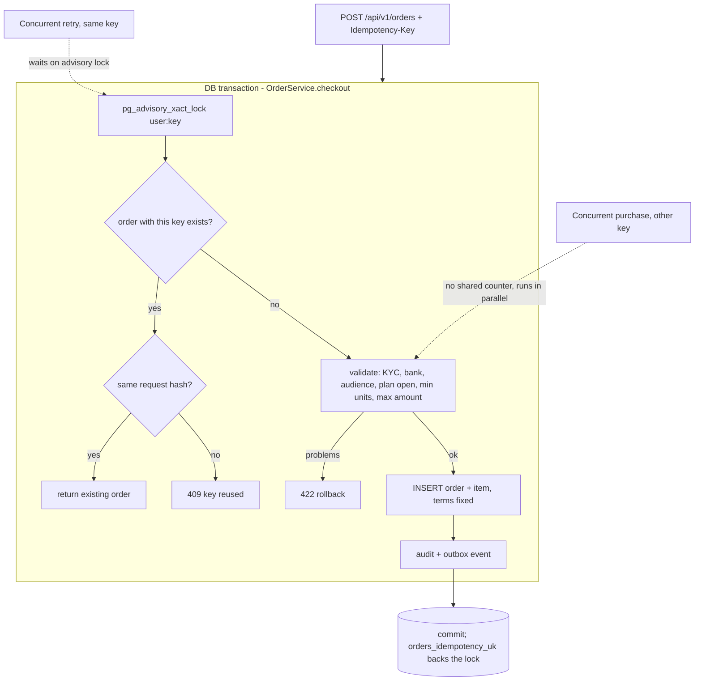

### 5.2 Withdrawal request

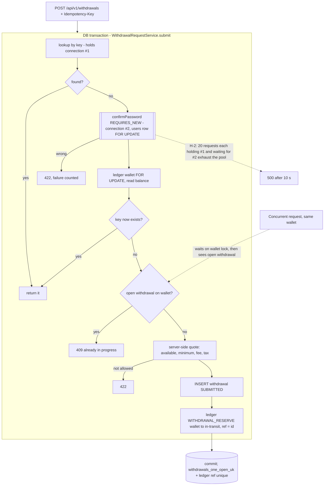

### 5.3 Withdrawal approval

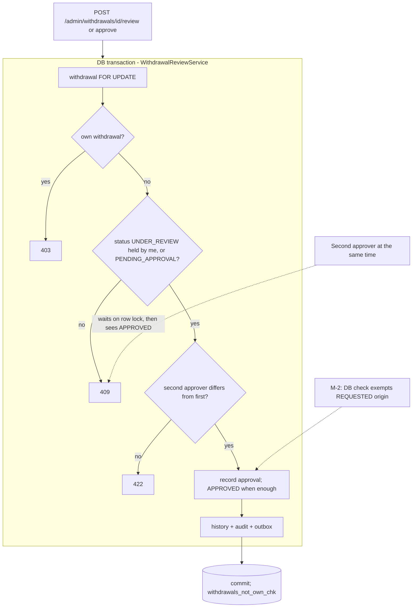

### 5.4 Payment initiation (withdrawals)

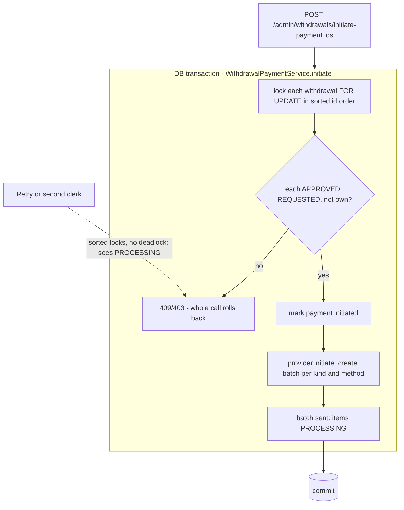

### 5.5 Payment webhooks (payout and Razorpay)

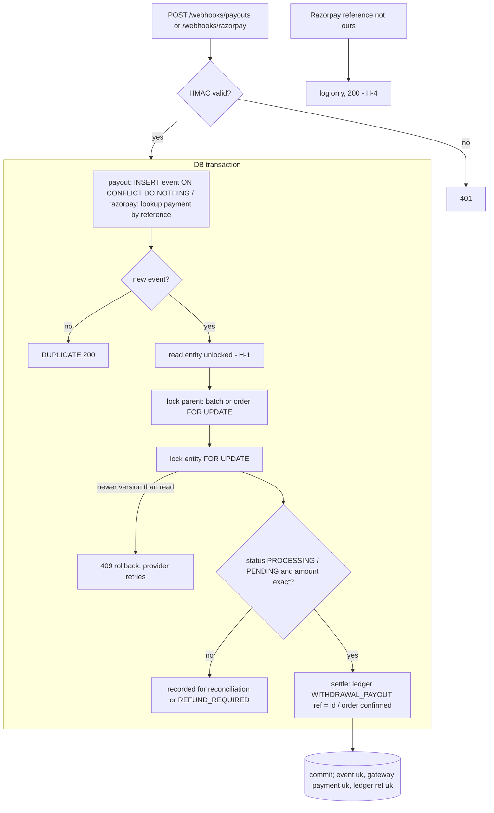

### 5.6 Payment retry after timeout

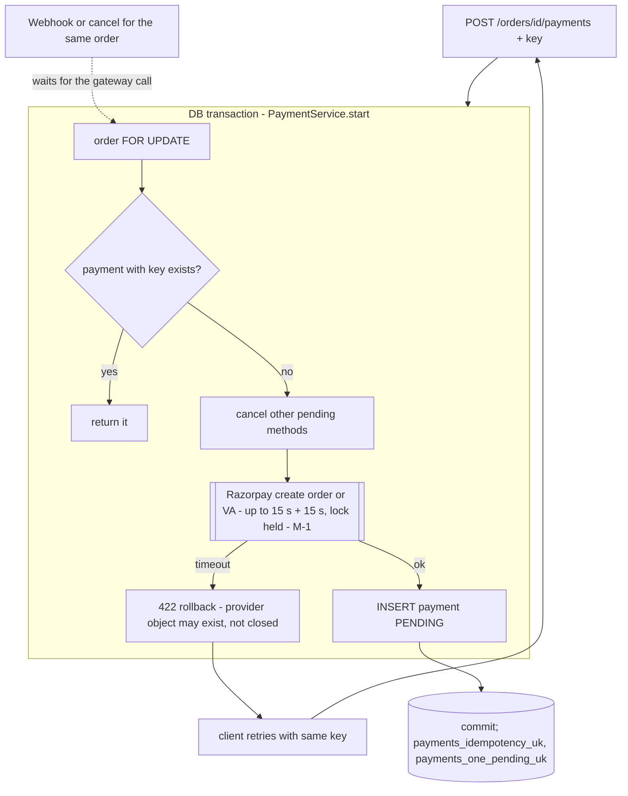

### 5.7 Interest (rent) calculation

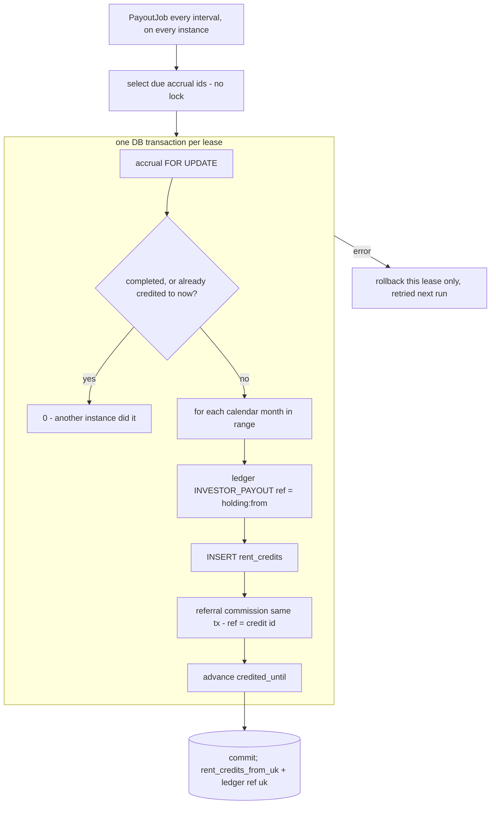

### 5.8 Refund

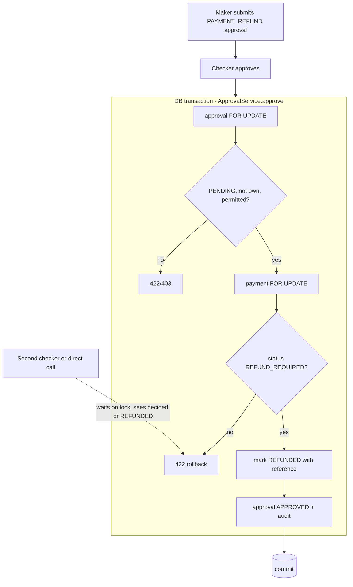

### 5.9 Investor balance update

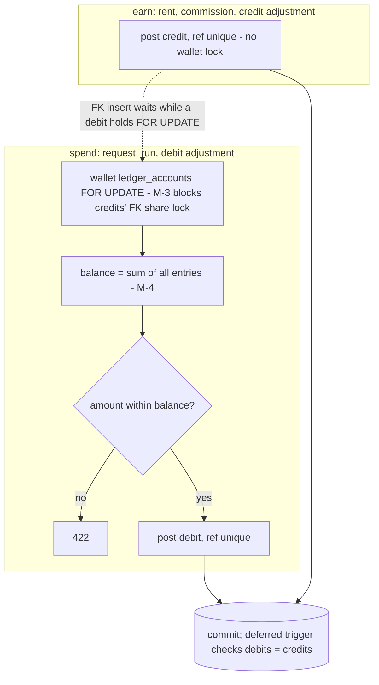

### 5.10 Ledger posting

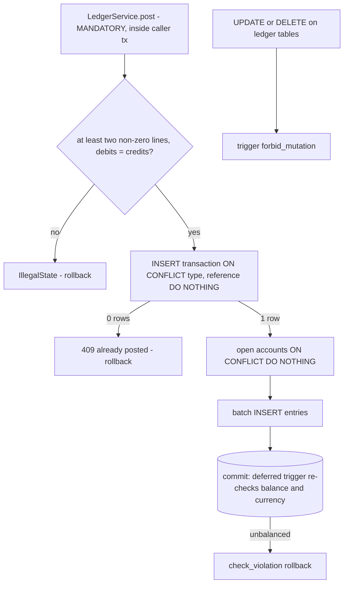

### 5.11 Scheduled jobs

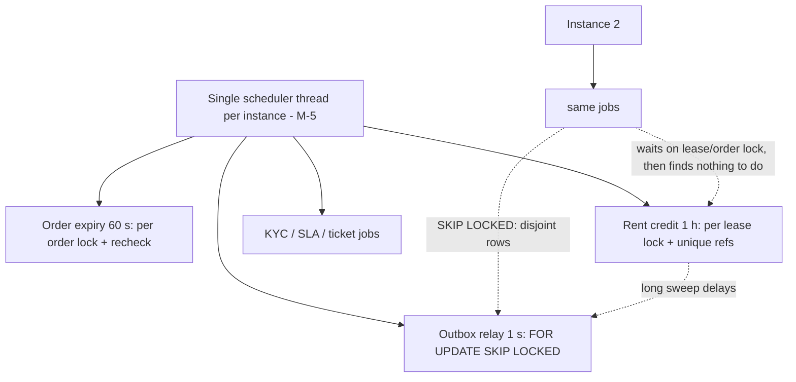

### 5.12 Reconciliation

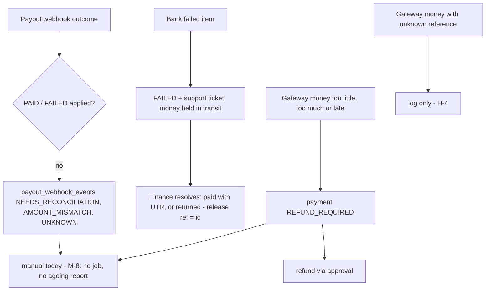

---

## 6. Database constraint recommendations

| Priority | Constraint | Purpose |
|----------|-----------|---------|
| HIGH | `payments_manual_reference_uk` (see H-3) | One bank or cash reference confirms one deposit |
| HIGH | `withdrawals_payout_reference_uk` (see H-3) | One UTR pays one withdrawal |
| HIGH | `unmatched_gateway_receipts` table (see H-4) | Record money with no matching payment |
| MEDIUM | Extend `withdrawals_approved_chk` to `REQUESTED` (see M-2) | Database-level maker-checker |
| MEDIUM | `account_balances (account_id PK, balance, last_entry_id)`, kept in step on posting | Constant-time balance (M-4); enables `CHECK (balance >= 0)` for investor accounts |
| LOW | Deferred trigger: every `ledger_transactions` row has ≥ 2 entries | Close L-1 |
| LOW | Unique index on `payout_webhook_events (provider, provider_reference) WHERE outcome = 'PAID'` | One paid event per bank reference |

The existing constraints are strong. Kept as-is:

- ledger `(transaction_type, reference)` unique;
- tables that can't be edited or deleted (ledger, invoices, events, notes, earnings);
- `withdrawals_one_open_uk`;
- `payments_one_pending_uk` and `payments_one_succeeded_uk`;
- `rent_credits_from_uk`;
- the referral uniques;
- the idempotency uniques;
- `withdrawals_charges_chk` (net = amount − fee − tax).

---

## 7. Locking strategy recommendations

1. **Lock before you read** (H-1). Any entity whose state decides an action must first be loaded with its lock. Never lock an instance that was loaded earlier in the same transaction. Use `refresh(entity, PESSIMISTIC_WRITE)` where the load can't be avoided.
2. **Keep the lock order fixed:**
   - order → payment;
   - batch → withdrawal;
   - approval → payment or wallet;
   - several rows of the same table in id order.

   No code path violates this today, and the tests saw 0 deadlocks across all races.
3. **Use `FOR NO KEY UPDATE` for wallet locks** (M-3). Spenders still serialise; credits no longer wait.
4. **No external calls while holding locks** (M-1, L-3). Commit first, then call the provider; or call first and record after.
5. **Keep transactions short:** one per investor in withdrawal runs (M-3) and one per lease in rent crediting (already done).
6. **Multi-instance jobs.** Database row locks and unique references are the real protection, and they hold. Add ShedLock or `SKIP LOCKED` only to save wasted work, not for correctness. Never rely on `synchronized` or in-memory locks.

## 8. Isolation level recommendations

- Keep PostgreSQL's default **READ COMMITTED** with explicit row locks. That's correct here: every decision is re-read after the lock, and each new statement sees committed data.
- Don't switch to `SERIALIZABLE` globally. It would add retry handling everywhere for no gain over the existing locks.
- `REPEATABLE READ` is useful only for read-only multi-query reports that must be self-consistent, such as the trial balance and statements. Use `@Transactional(readOnly = true, isolation = REPEATABLE_READ)` there.
- The stale-read problem in H-1 comes from Hibernate's first-level cache, not the isolation level. Changing isolation won't fix it.

## 9. Concurrency tests (executed)

`backend/src/test/java/com/sealease/backend/concurrency/FinancialConcurrencyIntegrationTest.java`: 12 tests, plus 2 acceptance tests for H-1 and H-2 that were `@Disabled` until the fixes; all 16 now pass. They run against PostgreSQL 18 (Testcontainers) with the production pool size of 20.

| Scenario | n | Result codes | Money invariants | p50 / max | Pool peak / waiting | Lock waiters (peak) | Deadlocks |
|----------|---|--------------|------------------|-----------|---------------------|---------------------|-----------|
| Withdrawal requests, one wallet, distinct keys | 100 | 201×1, 409×46, **500×50–52**, hung×1–3 | 1 withdrawal, 1 reserve, wallet 1000→600, no negative balance ✔ | **10.3 s / 10.9 s** | 20/20, 93–98 | 9 | 0 |
| Withdrawal retries, same key | 100 | 201×100 (same id) | 1 withdrawal ✔ | 0.2–0.5 s / 0.8 s | 14–20/20, 99–100 | 4–9 | 0 |
| Subscriptions: 10 purchases × 10 retries | 100 | 201×100 | 10 orders, 10 numbers, totals = items ✔ | 21 ms / 44 ms | 20/20, 56–67 | 9–10 | 0 |
| Gateway credits: 20 redeliveries + 10 other transfers | 30 | 200×11, **409×19** | Order confirmed once, 1 succeeded, 1 holding, 1 invoice, no gateway id twice ✔ | 38–43 ms | 20/20, 10–11 | 19 | 0 |
| Payout callbacks: 20 redeliveries + 10 ids | 30 | 200×24–29, **409×1–6** | PAID once, 1 payout posting ✔ | 33–64 ms | 17–20/20 | 15–19 | 0 |
| Overlapping rent sweeps (8 instances) | 8 | 1 sweep did 2,208 steps, 7 did 0 | Each hour once; postings = credits ✔ | 44–46 ms | 8/20 | 7 | 0 |
| Five approvers take one withdrawal | 5 | 200×1, 409×4 | One reviewer ✔ | 6 ms | — | — | 0 |
| Four second approvals at once | 4 | 200×1, 409×3 | APPROVED, two distinct approvers ✔ | 5 ms | — | — | 0 |
| Approve vs investor cancel (5 rounds) | 2 | 200×1, 409×1 each | Release posted iff cancelled; wallet consistent ✔ | 5–9 ms | — | — | 0 |
| Debits, credits and a withdrawal on one wallet | 21 | 201×17, 422×4 | Final = 1000 − debits − withdrawal + credits, ≥ 0 ✔ | 69–74 ms | 9/20, 13–14 | 7 | 0 |
| Payment start retries after a timeout | 1 + 10 | 422 then 201×10 (same id) | Nothing left by the failed attempt; 1 pending ✔ | 16–18 ms | 8–9/20 | 7–8 | 0 |
| Slow gateway vs order cancel | 2 | 201, 200 | — | cancel waited **1.3 s** (M-1) | 2/20 | 1 | 0 |
| Initiate payment ×5, one withdrawal | 5 | 200×1, 409×4 | 1 batch ✔ | 17–23 ms | 5/20 | 4 | 0 |
| Refund ×10, one payment | 10 | 200×1, 422×9 | REFUNDED once, 1 audit ✔ | 27 ms | 5–6/20 | 2–3 | 0 |
| Order expiry sweeps ×5 | 5 | 1 expired, 4 none | 1 expiry ✔ | 6 ms | — | — | 0 |

Ranges cover two runs. Run the suite with:

```
./mvnw -o test -Dtest=FinancialConcurrencyIntegrationTest
```

It prints `[concurrency-audit]` lines with these metrics.

**Not exercised:**

- A real multi-JVM deployment (the tests simulate instances with threads sharing one pool).
- Network partitions between the app and Razorpay or Kafka.
- Production-size ledgers (M-4 grows with data).

## 10. Performance analysis

- **Lock waits.** They are short (milliseconds) everywhere except H-2, where requests wait about 10 s for a connection rather than for a row lock. The highest number of sessions seen waiting on a lock was 19, in the webhook bursts, which serialise on one order or batch row by design.
- **Deadlocks:** 0 across all scenarios (consistent lock order).
- **Pool use.**
  - Bursts of 30–100 requests saturate the pool of 20. That's acceptable for short transactions (checkout handles 100 in 42–54 ms of wall time).
  - It fails when one request needs two connections (H-2).
  - It slows down when a request holds a connection during an external call (M-1, up to 30 s per stuck Razorpay call).
- **Bottlenecks, in order:**
  1. The nested transaction in withdrawal submit (H-2).
  2. Gateway calls under the order lock (M-1).
  3. Balance recomputation inside the wallet lock as ledgers grow (M-4).
  4. Whole-run withdrawal transactions blocking rent crediting (M-3).
  5. The single scheduler thread (M-5).
- **Throughput.** Checkout handled about 2,000 requests/s and same-key withdrawal retries 130–300 requests/s (MockMvc, in-process), with no errors. Distinct withdrawal requests on one wallet are serialised by design.
- **Failed transactions and retries.** The 409/422 answers in the table are expected refusals, except the 409s from H-1 (these become provider retries) and the 500s from H-2.

## 11. Prioritised remediation roadmap

| Order | Item | Effort | Risk if deferred |
|-------|------|--------|------------------|
| 1 | **H-2** password check outside the request transaction; enable its acceptance test | S | Withdrawal outage under load |
| 2 | **H-1** lock-first in `recordGatewayPayment`, `settleFromProvider`/`onWebhook`, deposit/confirm/reject, finance task; internal retry on version conflict; enable acceptance test | M | Unrecorded transfers if retries stop; staff errors |
| 3 | **H-3** reference uniqueness (data check, then partial unique indexes, then clear errors); consider deposit maker-checker | S–M | Investment confirmed without money; withdrawal "paid" twice from one UTR |
| 4 | **H-4** unmatched gateway receipts table + finance list | S | Money received with no record |
| 5 | **M-6** `lock_timeout` / `idle_in_transaction_session_timeout`; **M-5** scheduler pool size | S | Stuck requests or jobs |
| 6 | **M-1** gateway call outside the order lock + rollback cleanup | M | Contention; orphan virtual accounts |
| 7 | **M-3** `FOR NO KEY UPDATE` + per-investor run transactions | M | Rent crediting stalls during runs |
| 8 | **M-2** database approval check for requested withdrawals | S | Defence in depth |
| 9 | **M-8** reconciliation job + ageing report; **M-7** deposits in the ledger (design) | M–L | Manual reconciliation gaps |
| 10 | **M-4** balance snapshots; **L-1…L-4** | M | Latency grows with data |

Each fix should keep its own regression test in `FinancialConcurrencyIntegrationTest`. The existing roles, permissions and business rules stay unchanged.
